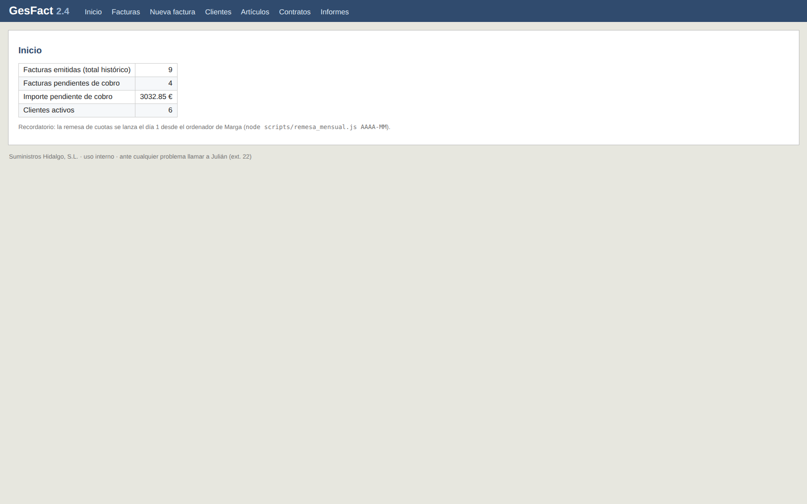
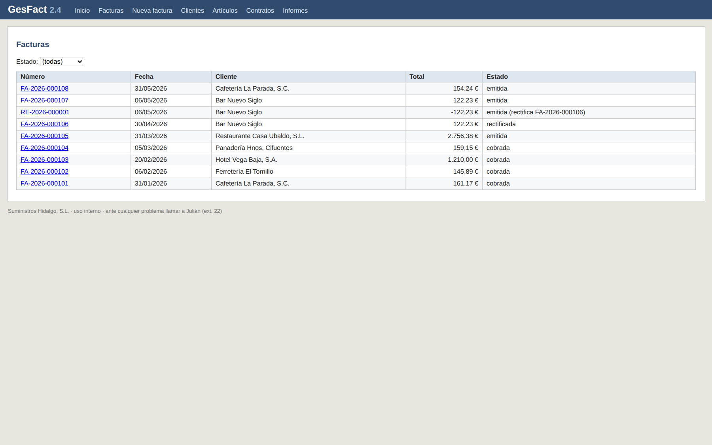
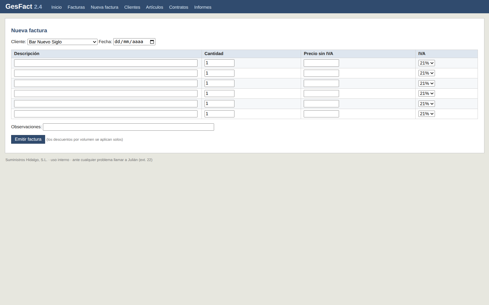
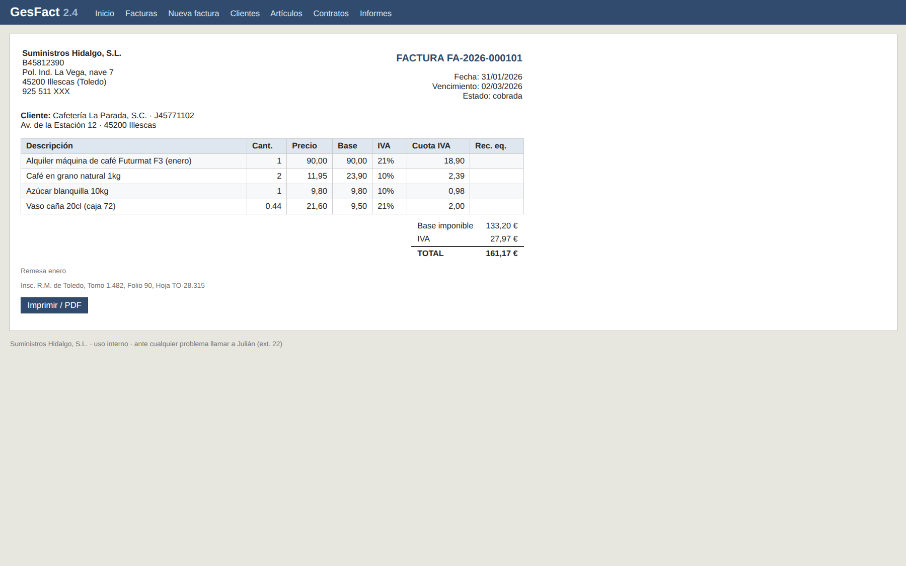
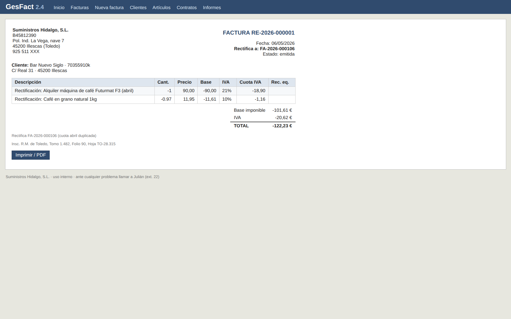
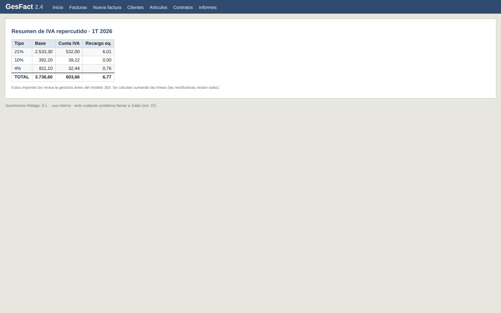

# GesFact 2.4 — sistema heredado de facturación

> **Aviso importante:** este repositorio contiene un **sistema heredado (legacy) en producción**.
> La fase actual es **documentar y proteger**, no mejorar. No se cambia ningún comportamiento
> observable (importes, redondeos, numeración, fechas, CSV, rutas o mensajes) sin una decisión
> escrita del negocio. Un bug aparente tampoco autoriza a corregirlo: se registra.

**Proyecto:** facturación real de Suministros Hidalgo, S.L.
**Versión:** 2.4.0
**Fecha de este documento:** 30 de octubre de 2026
**Estado:** reconocimiento cerrado; base preparada para continuar con Spec-Driven Development (SDD).

---

## 1. Qué es este proyecto

GesFact es el programa que emite las facturas de Suministros Hidalgo. Es un monolito Node.js con
Express, vistas EJS y una única base SQLite:

- `server.js`: arranque y montaje de rutas (`/clientes`, `/articulos`, `/contratos`, `/facturas`,
  `/informes`).
- `routes/`: emisión manual, cobro, rectificación, datos maestros, informes de IVA y CSV para la
  gestoría.
- `services/calculo.js` y `lib/`: cálculo de importes, redondeo por línea, recargos, descuentos,
  prorrateo, numeración de series `FA`/`RE`, fechas y formatos.
- `scripts/remesa_mensual.js`: emisión en lote de las cuotas de los contratos de un mes.
- `views/` y `public/`: interfaz de usuario.
- `datos/gesfact.db`: base local generada al arrancar. **La base real de producción no está en el
  repositorio.**

No tiene autenticación, control de accesos, migraciones ni tests de rutas. Es un sistema que
funciona y factura dinero real; precisamente por eso se trata como legacy.

---

## 2. El proceso: SDD inverso

En un proyecto nuevo, SDD (Spec-Driven Development) empieza por la especificación y termina en el
código. Aquí el orden se invirtió: **el código ya existe y no se puede cambiar**, así que primero
se reconstruyó la especificación a partir del sistema en funcionamiento. Eso es el **SDD inverso**:
derivar especificaciones, reglas y pruebas de un sistema heredado, sin modificarlo, para poder
continuar después con SDD «hacia delante» sobre una base fiable.

### 2.1 Fases ejecutadas

| Fase | Qué se hizo | Resultado |
|---|---|---|
| 0. Reconocimiento | Recorrer el sistema y documentar su estructura y su flujo real. | `mapa-sistema.md`, `flujo-factura.md` |
| 1. Evidencia | Cada afirmación se ancló a `fichero:líneas`, a una consulta real o a un testimonio con nombre y fecha. | Docs con evidencia y `SUPOSICIÓN` marcadas |
| 2. Reglas y contradicciones | Extraer las reglas que producen importes y fechas, y localizar dónde discrepan convención, código y operación. | 39 reglas `RN-*`, 9 contradicciones |
| 3. Tests de caracterización | Congelar el comportamiento actual con el runner nativo de Node, sin dependencias nuevas. | 116 comprobaciones, golden master de 12 operaciones |
| 4. Entrevista de negocio | Preguntar al negocio por las decisiones que el código no puede resolver. | 25 decisiones `D-*` (**simulación no ratificada**) |
| 5. Registro | Anotar lo que está mal, su impacto y su tratamiento, **sin corregirlo**. | 23 anomalías `A-*`, 28 riesgos `R-*` |
| 6. Partición | Repartir el sistema en specs formales revisables y trazables. | 9 specs propuestas (001–009) |
| 7. Base para SDD | Dejar el paquete listo para abrir specs, planes y tareas con el flujo Spec Kit. | `specs/SPEC-PACK.md` + `specs/000-reconocimiento/` |

### 2.2 Regla de oro del proceso

**No se ha modificado ni una sola línea de la aplicación, de la configuración ni de los datos.**
El trabajo de esta fase es documentación, evidencia y pruebas de caracterización. Los únicos
añadidos son documentos, capturas y tests; ninguna corrección de paso.

La normativa completa está en `.specify/memory/constitution.md`: comportamiento actual sagrado,
evidencia obligatoria, los hallazgos se registran y no se corrigen, cero dependencias nuevas y cero
refactors, todo en español de España.

---

## 3. Estado actual capturado

El 30 de octubre de 2026 se arrancó la aplicación y se capturó su estado con Chrome DevTools, a
1440×900, sobre la base local de ejemplo que crea `db.js` (no la base de producción). No se
registraron errores de consola. Las capturas están en
`specs/000-reconocimiento/capturas/`.

| # | Pantalla | Qué muestra |
|---|---|---|
| 01 | [Inicio](specs/000-reconocimiento/capturas/01-inicio.png) | 9 facturas históricas, 4 pendientes, 3.032,85 € pendiente, 6 clientes activos |
| 02 | [Facturas](specs/000-reconocimiento/capturas/02-facturas.png) | Listado FA/RE, incluida la rectificativa `RE-2026-000001` |
| 03 | [Nueva factura](specs/000-reconocimiento/capturas/03-nueva-factura.png) | Formulario de emisión manual con 5 líneas |
| 04 | [Clientes](specs/000-reconocimiento/capturas/04-clientes.png) | Listado y alta de clientes |
| 05 | [Artículos](specs/000-reconocimiento/capturas/05-articulos.png) | Listado y alta de artículos |
| 06 | [Contratos](specs/000-reconocimiento/capturas/06-contratos.png) | Listado y alta de contratos |
| 07 | [Informes](specs/000-reconocimiento/capturas/07-informes.png) | Accesos al informe de IVA y a la exportación para la gestoría |
| 08 | [Informe de IVA](specs/000-reconocimiento/capturas/08-informe-iva.png) | Desglose por tipo de IVA |
| 09 | [Factura de detalle](specs/000-reconocimiento/capturas/09-factura-detalle.png) | `FA-2026-000101`, cobrada, 161,17 € |
| 10 | [Rectificativa](specs/000-reconocimiento/capturas/10-factura-rectificativa.png) | `RE-2026-000001`, −122,23 €, rectifica `FA-2026-000106` |

**Galería**

| Inicio | Facturas |
|---|---|
|  |  |

| Nueva factura | Factura de detalle |
|---|---|
|  |  |

| Rectificativa | Informe de IVA |
|---|---|
|  |  |

> Los datos de las capturas proceden de la **base de referencia de ejemplo**, no de producción.
> El CSV para la gestoría no se capturó como pantalla porque la ruta fuerza una descarga; su
> formato se verificó por HTTP (clave `SH-CONTA-7731`, separador `;` y decimales con coma).

---

## 4. Resumen ejecutivo

El resumen ejecutivo completo, con prioridades y recomendaciones, está en
[`specs/SPEC-PACK.md` §1](specs/SPEC-PACK.md). Esta es la síntesis:

### 4.1 Qué se ha hecho

Se levantó el plano del programa que emite las facturas: qué hace, por qué, qué está mal y cómo
evitar que empeore. **No se tocó el sistema.** El paquete incluye 39 reglas de negocio, 9
contradicciones, 23 anomalías, 28 riesgos, 36 hitos históricos y **116 comprobaciones automáticas**
que hoy pasan todas. Además, el sistema quedó repartido en **9 specs** listas para abrir con SDD.

### 4.2 Qué se ha descubierto

- **Facturas que no cuadran.** De las 9 facturas de ejemplo, 6 tienen un total distinto a la suma
  de sus líneas. La `FA-2026-000105` muestra 2.756,38 € en el pie y 2.674,52 € en el detalle:
  **81,86 € de diferencia**. El CSV de la gestoría usa la cabecera y el informe de IVA usa las
  líneas, así que la misma factura cuenta distinto según la salida.
- **Dos formas de prorratear el mes de baja.** La pantalla usa 30 días y la remesa los días
  reales. Con una cuota de 90 € y baja el día 15: 45,00 € frente a 43,55 € en marzo, y 45,00 €
  frente a 48,21 € en febrero.
- **Descuentos sin explicación en la remesa.** Por encima de 1.000 € se aplica un 2 % y por encima
  de 5.000 € un 5 %; la factura manual lo anota y la de remesa no. Una cuota de 1.200 € sale
  29,04 € más barata al mes (348,48 € al año) sin que se vea el motivo.
- **Doble lanzamiento de la remesa.** No se comprueba si el mes ya se facturó; lanzarla dos veces
  duplica las facturas y consume numeración. Ya ocurrió en abril de 2026.
- **Fuera del cálculo:** no hay contraseña ni control de accesos; la copia es semanal aunque el
  negocio exige diaria; y las claves del correo y del fichero de la gestoría están en un fichero
  versionado.

### 4.3 Qué protección se ha instalado

**116 comprobaciones** con `npm test`, en unos 0,13 s. Fijan importes, fechas, numeración y el
contenido del CSV, y fallan si algo cambia aunque sea un céntimo. La pieza central es un **golden
master de 12 operaciones completas**. Protegen el cálculo y las reglas puras; **no** ejecutan aún
las pantallas ni la remesa completa.

### 4.4 Qué decisiones tiene pendientes el negocio

| Prioridad | Decisión | Recomendación |
|---|---|---|
| 1 | **Ratificar el acta de 25 decisiones.** Hoy es una simulación sin firma. | Sesión con Puri, Marga, Paco y Julián; firmar o corregir. Sin esto, ninguna decisión es exigible. |
| 2 | **Facturas históricas descuadradas.** | No modificarlas; anexo de conciliación y suma de líneas también en el histórico. |
| 3 | **Procedimiento de arranque y restauración.** Hoy depende de Julián. | Marga responsable, Julián autor técnico; prueba trimestral sobre copia desechable. |
| 4 | **Factura incompleta y rectificación a medias.** | Abono espejo y factura nueva, sin editar la base; la original solo pasa a «rectificada» con el abono completo. |
| 5 | **Abono cobrable, orden de la remesa y alta de contratos.** | No cobrar la `RE`; numerar por contrato ascendente; alta por plantilla SQL mientras no haya pantalla. |

**Estado real de las decisiones:** el acta de 2026-10-30 es una **simulación no ratificada**
(`specs/000-reconocimiento/acta-entrevista-negocio.md`). Quedan **7 propuestas del analista**
(`RESUELTA_PROPUESTA`: A-06, A-07, A-08, A-17, A-18, A-19 y A-20) y **3 rarezas técnicas**
(`ABIERTA_TECNICA`: A-21, A-22 y A-23). Nada de lo decidido está implementado: la constitución
congela la implementación hasta que el negocio firme.

---

## 5. Cómo ejecutar el proyecto

Requisitos: Node.js (verificado con Node 24) y las dependencias ya instaladas o instalables.

```bash
npm install --no-package-lock   # solo la primera vez; el package-lock está incompleto
npm start                        # = node server.js → http://localhost:3000
npm test                         # TZ=Europe/Madrid node --test test/*.test.js
```

Ejecutar siempre desde la raíz del repositorio: `config.RUTA_BD` es relativa
(`./datos/gesfact.db`). El primer arranque crea el esquema y siembra datos de ejemplo si la tabla
`clientes` está vacía.

Comandos útiles:

```bash
node --test test/calculo.test.js
TZ=Europe/Madrid node --test --test-name-pattern="redondeo" test/*.test.js
```

### Advertencias operativas

- **`node scripts/remesa_mensual.js YYYY-MM` emite facturas reales** en la base configurada. No lo
  ejecutes contra datos reales ni como parte de las pruebas. Usa una copia desechable del repo.
- `datos/gesfact.db` es generada y está excluida de git; la base de producción no está aquí.
- `LEEME.txt` está desactualizado (habla de Node 8); este README y `specs/SPEC-PACK.md` son la
  referencia vigente.
- `config.js` contiene credenciales en texto plano y está versionado. Es un riesgo registrado
  (R2); no lo copies ni lo publiques.

---

## 6. Estructura del repositorio

```
.
├── server.js                 # arranque Express + EJS
├── config.js                 # empresa, puerto, ruta de BD, claves
├── db.js                     # esquema SQLite, siembra y acceso a datos
├── routes/                   # clientes, artículos, contratos, facturas, informes
├── services/                 # cálculo y correo (stub desactivado)
├── scripts/                  # remesa mensual y regeneración del golden master
├── lib/                      # numeración, utilidades y formato
├── views/                    # plantillas EJS
├── public/                   # CSS y JS de interfaz
├── test/                     # 116 tests de caracterización + golden master
├── specs/
│   ├── SPEC-PACK.md          # punto de entrada al paquete de reconocimiento
│   └── 000-reconocimiento/   # documentos de reconocimiento + capturas del estado actual
├── .specify/                 # constitución, plantillas y flujo Spec Kit
└── README.md                 # este documento
```

---

## 7. Documentación de referencia

| Documento | Para qué sirve |
|---|---|
| [`specs/SPEC-PACK.md`](specs/SPEC-PACK.md) | Punto único de entrada: resumen ejecutivo, riesgos, índice y cobertura. |
| [`specs/000-reconocimiento/mapa-sistema.md`](specs/000-reconocimiento/mapa-sistema.md) | Piezas del sistema y zonas oscuras. |
| [`specs/000-reconocimiento/flujo-factura.md`](specs/000-reconocimiento/flujo-factura.md) | Ciclo de vida de una factura: emisión, cobro y rectificación. |
| [`specs/000-reconocimiento/reglas-de-negocio.md`](specs/000-reconocimiento/reglas-de-negocio.md) | Las 39 reglas que producen importes y fechas. |
| [`specs/000-reconocimiento/contradicciones.md`](specs/000-reconocimiento/contradicciones.md) | Las 9 discrepancias entre convención, código y operación. |
| [`specs/000-reconocimiento/registro-anomalias.md`](specs/000-reconocimiento/registro-anomalias.md) | Qué está mal, con evidencia, estado y decisión. |
| [`specs/000-reconocimiento/registro-riesgos.md`](specs/000-reconocimiento/registro-riesgos.md) | Deuda técnica y exposición operativa (R1–R28). |
| [`specs/000-reconocimiento/memoria-historica.md`](specs/000-reconocimiento/memoria-historica.md) | Historia del sistema en 36 hitos y el porqué de sus rarezas. |
| [`specs/000-reconocimiento/acta-entrevista-negocio.md`](specs/000-reconocimiento/acta-entrevista-negocio.md) | 25 decisiones y 6 prohibiciones (**simulación no ratificada**). |
| [`specs/000-reconocimiento/propuesta-particion-specs.md`](specs/000-reconocimiento/propuesta-particion-specs.md) | Reparto en 9 specs con trazabilidad regla/anomalía. |
| [`test/COBERTURA.md`](test/COBERTURA.md) | Qué congela la red de tests y qué queda fuera. |
| [`.specify/memory/constitution.md`](.specify/memory/constitution.md) | Normativa innegociable vigente del proyecto. |
| [`specs/000-reconocimiento/constitucion-v1.0.0.md`](specs/000-reconocimiento/constitucion-v1.0.0.md) | Copia congelada de la constitución v1.0.0 que rigió la fase 0, antes de su próxima modificación. |

---

## 8. Qué falta y cómo continuar con SDD

La base está preparada, pero **la modernización no ha empezado**. Antes de escribir código:

1. **Ratificar el acta de negocio.** Sin firma, las 25 decisiones y las 7 propuestas siguen siendo
   provisionales.
2. **Cerrar la deuda de pruebas.** Las rutas HTTP y la remesa end-to-end no están cubiertas; son
   la primera tarea de la siguiente fase (`SPEC-PACK.md` §4.3).
3. **Abrir las specs con el flujo SDD.** La partición aprobada para revisión está en
   `propuesta-particion-specs.md`; cada spec se abre con `/speckit-specify` y se convierte en
   plan, tareas e implementación.
4. **No implementar nada decidido hasta que esté ratificado.** La constitución lo prohíbe y el
   registro de anomalías distingue explícitamente entre decisión de negocio y propuesta del
   analista.

Orden previsto de las specs: `001` cálculo → `002` emisión manual → `003` cobro y rectificación →
`004` numeración → `005` contratos y prorrateo → `006` remesa → `007` informes y CSV → `008` datos
maestros y formatos → `009` operación y continuidad.

---

## 9. Convenciones del proyecto

- **Idioma:** español de España en documentación, commits, nombres y descripciones de tests.
- **Estilo:** ES5 (`var`, callbacks), plantillas EJS, sin capas nuevas.
- **Evidencia:** toda afirmación sobre el sistema cita `fichero:líneas`, dato real o testimonio con
  nombre y fecha. Lo no verificado se marca `SUPOSICIÓN` y se convierte en pregunta.
- **Hallazgos:** se registran, no se corrigen. Nunca se arregla algo «de paso».
- **Dependencias:** cero nuevas, cero actualizaciones, cero refactors o reformateos.

---

**Uso interno.** Proyecto `UNLICENSED` de Suministros Hidalgo, S.L. Ante cualquier problema,
llamar a Julián (ext. 22).
